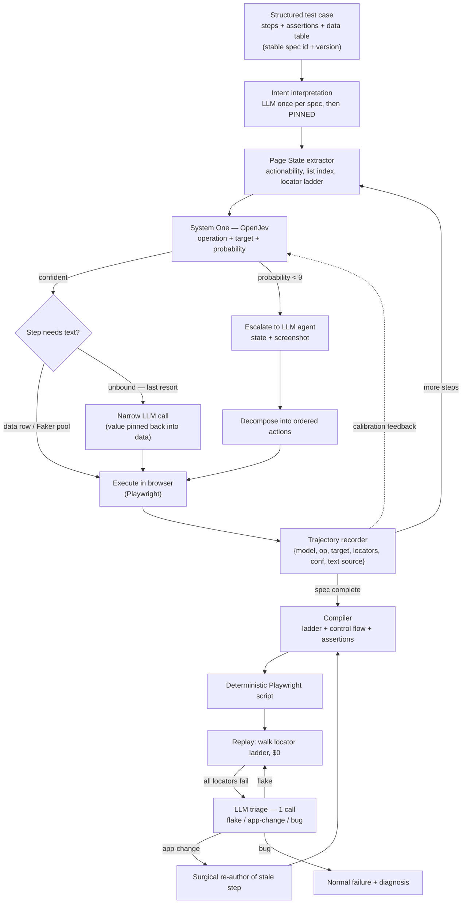

# jev-harness

> **Design v2 — full design, not a build.** This repo holds the architecture and
> phased plan. v2 is a critical rewrite of v1: the review flagged six structural
> gaps, all fixed here. The design is pre-implementation; Phase 0 gates must pass
> before scaling.

## One line

A **hybrid browser-test authoring harness**: a cheap *System One* decision model
(OpenJev) answers routine UI steps in one forward pass with calibrated
probabilities; an expensive LLM runs only on exceptions — low-confidence steps,
first-authoring of a spec, unbound test text, or total replay failure. Every
decision is recorded as a **trajectory** and compiled into **deterministic
Playwright** that replays for $0, with self-healing and one-shot LLM triage as
the *exception* path, not the default.

## Why this exists

Two broken ends of the spectrum:

- **Full AI agents** (a large model on every step) are slow, expensive, and
  non-deterministic — the same test can fail twice for two different reasons.
- **Classic record-and-replay** is cheap and deterministic but brittle: manual
  authoring, and every DOM change kills tests — the flaky-test plague, by
  construction.

The observation this project tests:

> The vast majority of browser-automation decisions are routine and bounded
> ("click the button labelled X", "type into field Y"). A ~200ms typed-decision
> model answers these well. Reserve the expensive model for the small fraction
> that genuinely needs it — and, at run time, for failures only.

## Four layers

| Layer | Role | Cost | When it runs |
|-------|------|------|--------------|
| **System One** (OpenJev, open weights) | Routine decisions: operation + target + probability | ~210ms, ~1.5k prompt tokens per decision; GPU-served (vLLM) | Every step, authoring |
| **LLM agent** (Claude/GPT-class) | Ambiguity; spec intent interpretation (pinned after first use); unbound text; replay-failure triage | $0.01–0.10+ per call | Exceptions only |
| **Deterministic replay** (Playwright) | Pure code; multi-locator ladder; $0 marginal cost | $0.00 | Test time — the default path |
| **Self-healing + triage** (LLM, on-exception) | When *all* locators fail: one call classifies flake / app-change / bug and routes (retry / re-author / report) | One call only when the ladder fails | Test time — the exception path |

Replay is **determinism-first, model-on-exception**: the overwhelming majority of
runs use no model; the model appears only when deterministic replay cannot
self-heal.

## Architecture at a glance

## What v2 fixed vs v1

1. **Real model numbers, not fantasy.** The plan is driven by OpenJev's measured
   profile (~210ms, ~1.5k prompt tokens per web decision, 84% per-decision
   accuracy on its 10k general benchmark) and its serving cost (vLLM +
   H100-class GPU) — the GPU line is now in the cost model.
2. **The gate is the decision-relevant metric.** Phase 0 / R1 gates on
   **post-escalation per-step error rate on your own domain corpus**, not raw
   calibration (ECE). A confident-wrong click at 0.7 kills a whole test; ECE
   does not measure that.
3. **Text steps can't sink the economics.** Test text comes from a **data table
   / Faker pool first**; the LLM generates only what no binding covers, and the
   generated value is pinned back into the data table. The text-step ratio is
   measured per domain (R3) before any cost claim.
4. **Self-healing is core, not a late-phase patch.** Every recorded target
   carries a multi-locator ladder; replay walks it; total failure triggers the
   bounded exception path. v1's "no model at test time" purity would have
   rebuilt the flaky-test plague at a slower cadence.
5. **Failure triage is a first-class phase.** The expensive part of test
   ownership was never authoring — it's triage (bug vs flake vs env). One LLM
   call on replay failure classifies and routes, including surgical re-author of
   stale steps.
6. **Authoring is deterministic per spec.** Free-text intent lines are replaced
   by a **structured test case** (steps + assertions + data table, stable spec
   id); intent interpretation is pinned after first authoring so two runs of the
   same spec diff cleanly. Plus an explicit **snapshot boundary**: what Page
   State can and cannot represent (iframes/shadow in, canvas/WebGL out).

## Where the risk is (v2 priority order)

1. **Post-escalation error rate on your own domain** — OpenJev's 84% is a
   general benchmark; your forms may be 95% or 70%. Prove it (R1).
2. **Self-healing coverage** — the ladder + exception path must hold flake rate
   under target across real DOM drift (R4).
3. **Triage precision** — a misrouted "flake" hides a real bug (R6).
4. Snapshot boundary & fidelity (R2).
5. Compiler round-trip (R5).

## Repo layout

- `README.md` — this overview.
- [`docs/ARCHITECTURE.md`](docs/ARCHITECTURE.md) — full design: layers, spec schema, page state, OpenJev, cost model, baselines.
- [`docs/PHASES.md`](docs/PHASES.md) — gated development / testing / deployment plan.
- [`docs/ROADMAP.md`](docs/ROADMAP.md) — research order and pass criteria.

**Do not treat this as final** — v2 is a critically-rewritten scaffold; the
Phase 0 gate decides what changes next.
