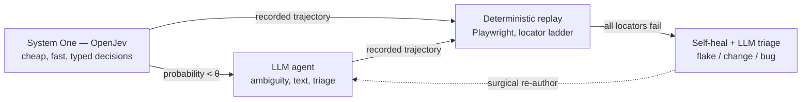
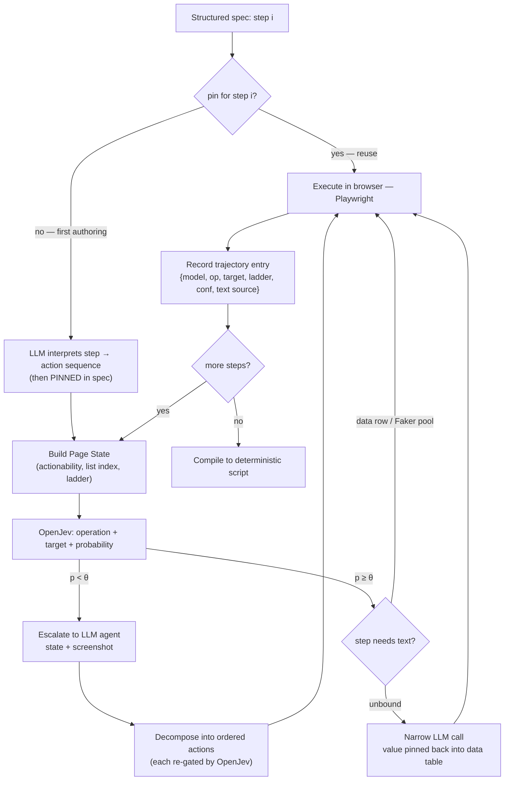

# jev-harness — Architecture (v2, DRAFT)

> Full design, v2. Sections touched by the critical review are marked **[v2]**.
> Risk-carrying items are flagged **[RESEARCH]** with the roadmap item that
> resolves them. Pre-implementation: Phase 0 gates decide what changes.

## 1. Problem statement

AI-driven UI testing calls a large model on every step: slow, expensive, and
non-deterministic at scale. Classic record-and-replay is cheap and
deterministic but brittle — manual authoring, and every DOM change kills
tests. v1 answered the cost problem (hybrid authoring) but left the brittleness
problem in the replay path: recorded locators go stale, and a "deterministic"
test that dies on every release is just the flaky-test plague on a slower
cadence. v2 answers both.

## 2. The four layers



- **System One (OpenJev)** answers *bounded, typed questions* — operation
  choice, target choice — in one forward pass with a probability per option.
  No free text, no chain-of-thought, no parsing. Cheap and low-variance.
- **LLM agent** runs only on exceptions: probability below θ, first-time spec
  interpretation, unbound text, replay-failure triage.
- **Deterministic replay** compiles the trajectory into Playwright that walks a
  multi-locator ladder. No model, $0 — the default path.
- **Self-healing + triage** is the bounded exception path: on total ladder
  failure, one LLM call classifies the failure and routes it. This layer is
  what makes "author once, replay for years" credible **[v2 — fix 3+4]**.

## 3. Structured test case — the authoring interface **[v2 — fix 5]**

Free-text intent lines (v1) made *authoring* non-deterministic: same prose, two
runs, two trajectories — undiffable, unauditable. v2 puts a **structured spec**
at the top:

```json
{
  "spec_id": "auth.login-success",
  "version": 3,
  "steps": [
    { "id": "s1", "text": "Open the sign-in page" },
    { "id": "s2", "text": "Enter valid credentials" },
    { "id": "s3", "text": "Log in" }
  ],
  "assertions": [
    { "id": "a1", "after": "s3", "text": "Dashboard greets the user by name" }
  ],
  "data": {
    "source": "tables/auth_users.csv",
    "rows": [
      { "label": "valid",  "username": "testuser",   "password": "$VAULT:valid-pass" },
      { "label": "locked", "username": "lockeduser", "password": "irrelevant" }
    ]
  },
  "pins": {
    "s2": {
      "interpreted": ["type into Username", "type into Password", "click Log in"],
      "pinned_by": "claude-2026-11-01",
      "pin_hash": "9f2c…"
    }
  }
}
```

Rules:

- **One LLM call per spec, ever.** `pins` records the LLM's step →
  action-sequence interpretation on first authoring. Re-authoring reuses the
  pin; two runs of the same spec diff cleanly. A pin is re-interpreted only on
  explicit spec-version bump or when triage says the step itself changed.
- **Text from data first.** Type steps reference a data row/label. No binding
  → Faker-style pool. LLM generation is the last resort, logged as such, and
  the generated value is pinned back into the data table (generated once).
- **Assertions are spec-level, human-authored expectations.** The harness does
  extraction + comparison and records the rule, so replay re-checks the same
  rule deterministically.
- **spec_id + version are stable keys** for trajectories, compiled scripts,
  and triage history.

## 4. Page State — the critical abstraction, with an explicit boundary **[v2 — fix 6]**

```json
{
  "url": "…",
  "frame_path": ["main"],
  "heading": "Sign in to your account",
  "elements": [
    { "id": 12, "role": "textbox", "label": "Username",
      "actionable": true, "covered_by": null, "disabled": false,
      "list_index": null,
      "locators": ["data-testid=login-user", "role=textbox[name=Username]",
                    "css=input#user", "text≈\"Username\""] }
  ]
}
```

Changes vs v1:

- **Actionability.** Present ≠ actionable. Modal/overlay-covered, disabled, or
  off-viewport elements carry `covered_by` / `disabled` flags so the classifier
  decides on what a human *could* click, not what exists in the DOM.
- **List position.** Repeated / virtualized elements are `(role, label,
  list_index)`, so "delete item 3" is expressible. Fifty identical "Delete"
  buttons resolve by index, not label collision.
- **Frames & shadow DOM.** Same-origin iframes and open shadow trees are
  flattened into the snapshot with their frame path. Closed shadow roots are a
  documented loss.
- **Locator ladder per element [v2 — fix 4].** Every element carries an ordered
  ladder captured at snapshot time: `data-testid` → `role + accessible name`
  → stable CSS → visible-text anchor → position/visual. The ladder is what
  replay self-healing walks (§7). Ladder capture cost is measured in R2 — it is
  the price of fix 4.
- **Boundary, declared not discovered in production.**
  - *In:* DOM (incl. same-origin iframes, open shadow), text, roles, labels,
    values, visibility, list position.
  - *Out:* canvas/WebGL-only UIs (games, canvas charts, canvas-based rich
    editors), PDF/video players. The snapshot literally cannot see them; any
    app whose critical path is canvas is out of pilot scope.
- **Stable element identity.** A content-hash fingerprint that survives
  re-render, so `target_id` means the same element between steps.

> **[RESEARCH R2]** The snapshot is the system's ceiling: measure wrong-call
> rate, escalation rate, and build cost (ms + tokens inside OpenJev's option
> budget) per representation variant.

## 5. System One — OpenJev, with real numbers **[v2 — fix 1]**

v1 treated "Jev" as an off-the-shelf black box with fantasy latency. v2 names
the concrete stack and its measured profile:

- **Model.** OpenJev (open weights): a typed-decision model. You ask bounded
  questions with *your own labels in the request*; it scores each option at the
  first output position — one forward pass, no free text, no parsing, no
  per-task training. Up to 52 options per question.
- **Measured profile** (OpenJev's own benchmark): ~210ms per isolated web
  decision (~1.5k prompt tokens, ~23 candidate elements) on one H100;
  **84.0% per-decision accuracy** on a 10k general UI benchmark (Jev hosted
  API: 85.4%).
- **Serving.** vLLM (fp8) + the OpenJev shim in front. This is real infra cost
  — one H100-class GPU shared across authoring jobs, amortized in the cost
  model (§8). Not a "fractions of a cent" hand-wave.
- **Two typed questions per step.**
  1. `OPERATION ∈ {CLICK, TYPE_TEXT, SELECT, SCROLL, WAIT, DONE, BLOCKED}`
  2. `TARGET ∈ snapshot element ids` (≤ 52; larger pages pruned to a candidate
     set — pruning strategy is part of R2)
- **Threshold gate.** Execute if probability ≥ θ; below θ escalates. v1's
  draft θ = 0.65 is a placeholder. v2's hypothesis to test (R1): on your own
  domain, the **confident subset** (p ≥ θ) reaches ≥ 99% per-step accuracy at
  an escalation rate the cost model still supports. θ is tuned per task class
  and re-tuned on drift.
- **The gate metric is post-escalation per-step error rate** — the residual
  after the escalation path takes over. ECE/Brier are recorded as supporting
  evidence, not the gate: a confident-wrong decision is the error that kills
  tests, and that is what this metric measures.

> 84% is a *general* benchmark. Your domain (forms? tables? dashboards?) may
> score 95% or 70%. **R1 measures OpenJev on your own sample suite before any
> build commitment.** If the confident subset cannot clear the error bound,
> the economics do not hold and the design stops here — that is the correct
> place for it to stop.

## 6. The authoring loop **[v2]**



**Text supply hierarchy [v2 — fix 2]** for every TYPE_TEXT step:

1. Data row bound in the spec (env / CSV / vault ref) — free, deterministic.
2. Faker-style pool (names, addresses, format-matched numbers) — free.
3. LLM generation — last resort; logged, costed, value pinned back.

Why it matters: v1 routed *every* type step to a narrow LLM call. On form-heavy
flows — the obvious pilot domain (auth, checkout) — that silently degraded the
hybrid to full-AI cost. With the hierarchy, LLM text calls are rare *by
construction*. R3 measures the text-step ratio per domain as a first-class
metric; the 10–30× claim is made only for domains whose ratio supports it.

**Escalation & decomposition.** The LLM sees snapshot + optional screenshot and
returns natural language, which the harness decomposes into ordered actions;
each decomposed action is re-gated by OpenJev where applicable
(decompose-then-verify), and executed one at a time with state re-extraction
between each.

## 7. Deterministic replay, self-healing, and triage **[v2 — fixes 3+4]**

v1's flaw: replay re-executes *recorded* locators, so any DOM change between
authoring and replay kills the test. v2: **determinism-first, model-on-exception.**

Replay per action:

1. **Walk the ladder** — testid → role+name → css → text anchor → position.
   Pure code, deterministic order, deterministic outcome. $0.
2. **All fail → one LLM exception call** with screenshot + snapshot, which
   classifies the failure:
   - **Flake** (timing / transient / env) → retry with the fallback ladder, at
     most K retries; pass or fail on evidence.
   - **App change** (element genuinely moved/renamed) → mark the step STALE,
     emit a **surgical re-author job** for just that step through the authoring
     loop; spec version bumps; old trajectory archived.
   - **Bug** (app misbehaves) → normal test failure, with the LLM's diagnosis
     attached to the report.

Properties:

- **The $0 path stays $0.** Exceptions are bounded (K retries, budget caps,
  §8) and logged; their cost is measured (R4) and budgeted, not absorbed
  silently.
- **Re-authoring is surgical.** Only the stale step goes through models; the
   rest of the compiled script is untouched. This is the feature that makes
   "author once, replay for years" credible — the same value Testim/Mabl/
   Katalon sell as self-healing, with a deterministic core underneath.
- **Self-healed locators are promoted.** A fallback that worked is appended to
   that element's ladder (feedback into future snapshots), so exceptions should
   trend to zero on stable apps.
- **Triage accuracy is a measured gate (R6).** A misclassified "flake" hides a
  real bug; a misclassified "app change" burns re-authoring budget. Precision
  and recall per class, on a real failure corpus, are Phase 8 exit criteria.

## 8. Cost model **[v2 — fix 1]**

Authoring — per 10-step flow (8 routine + 1 text + 1 escalation):

| Item | v1 (hand-wave) | v2 (measured profile) |
|------|----------------|------------------------|
| System One decisions | "~15 Jev calls, sub-100ms, fractions of a cent" | ~10 OpenJev decisions × ~210ms × ~1.5k tokens ≈ 15k prompt tokens + GPU amortization |
| LLM escalations | 1–2 calls | 1–2 calls (same) |
| Text generation | *(missing — every type step)* | data/Faker first; LLM text ≈ 0–1 calls, pinned on generation |
| Intent interpretation | *(missing)* | 1 LLM call per spec, first authoring only; $0 thereafter (pinned) |

Replay — per run:

| Path | Target frequency | Cost |
|------|-----------------|------|
| Pure ladder replay | ≥ 95% of runs | $0.00 |
| Exception: triage call (+ re-author on change) | ≤ 5% of runs, bounded by K and budget caps | one LLM call + at most one surgical authoring pass |

**GPU serving:** one H100-class instance shared across authoring jobs,
amortized per authored test. This line did not exist in v1 — it is real money
and it appears in the R3 baseline comparison.

Full-AI baseline (per *run*, for contrast): ~10 large-model calls,
$0.30–1.50, ~5–20s/step, non-deterministic.

## 9. Baselines — what we must beat **[v2 — fix 1 continued]**

The value proposition is judged on **total cost of test ownership** — not
authoring cost alone:

| Baseline | Authoring | Run cost | Flake behavior | Triage cost |
|----------|-----------|----------|----------------|-------------|
| Human-written Playwright | engineer-hours | $0 | DOM change → engineer fixes | engineer time |
| Self-healing vendors (Testim / Mabl / Katalon) | low-code | vendor $/test | vendor heuristic healing | vendor support, partial |
| Full LLM agent (browser-use-class) | ~$0.30–1.50 per run | $ per step | non-deterministic | engineer reads agent logs |
| **jev-harness** | ~$0.01–0.05 + minutes | $0 + ≤ 5% exceptions | ladder + bounded triage + surgical re-author | 1 LLM call, routed |

R3 runs all four on the same suite over a 30-day replay window and compares:
authoring cost, authoring time, flake rate, triage time per failure, and
**bug detection** (the harness must not hide real bugs via triage
misclassification).

## 10. Trajectory data model **[v2]**

```json
{
  "spec_id": "auth.login-success", "spec_version": 3,
  "step": 2, "step_id": "s2",
  "page_state_hash": "a3f9…",
  "decision": {
    "model": "openjev", "operation": "TYPE_TEXT",
    "target_id": 12, "confidence": 0.93,
    "locators": ["data-testid=login-user", "role=textbox[name=Username]", "css=input#user"]
  },
  "text": { "source": "data:tables/auth_users.csv#valid", "value": "testuser" },
  "action_executed": "page.fill('[data-testid=login-user]', 'testuser')",
  "escalated": false,
  "timestamp": "2026-11-01T09:14:22Z"
}
```

Compiler invariants (R5):

- **Round-trip:** the compiled script re-executes the recorded trajectory
  exactly — same ladder order, same text, same assertion rules.
- **Full ladder preservation:** *all* ladder entries are compiled, not just
  the one that worked at authoring (the authoring success path is the weakest
  signal — the page may have been in a transient state).
- **Assertions compile** to extract + compare rules with the same ladder
  treatment for their targets.
- **Audit header:** spec pin + version + model ids are embedded in the
  generated script.

## 11. Hard problems — v2 priority order

1. **Post-escalation error rate on your own domain** (R1) — 84% is a general
   benchmark; only your numbers decide the economics. Highest.
2. **Self-healing coverage** (R4) — ladder + bounded exception path must hold
   flake rate under target across real drift; this is the product.
3. **Triage precision** (R6) — a misrouted "flake" hides bugs; a misrouted
   "change" burns re-authoring budget.
4. **Snapshot boundary & fidelity** (R2) — the ceiling of everything, now with
   an explicit boundary (canvas/WebGL out).
5. **Compiler correctness** (R5).
