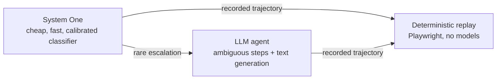
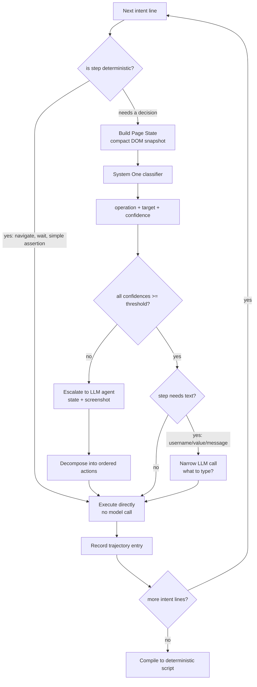

# jev-harness — Architecture (DRAFT)

> Working design. Priority items are flagged **[RESEARCH]** because they carry the
> real risk and must be validated before scaling.

## 1. Problem statement

AI-driven UI testing calls a large model on every step, which is slow and costly at
scale. Most steps are *routine* (click labelled button, type into labelled field) and
do not need a big model. This project authors tests with a **hybrid** of a cheap
classifier and an expensive LLM, then compiles the recorded trajectory into pure
deterministic code that replays for free.

## 2. The three worlds



- **System One** answers *bounded, typed questions*: "which operation?" and which
  element? It returns a **confidence** score. It cannot generate free text, plan, or
  see images — by design it is cheap and low-variance.
- **LLM agent** runs only when System One's confidence is below threshold, or when a
  step needs dynamic text / reasoning. It sees the page state and (optionally) a
  screenshot, returns natural language that the harness **decomposes** back into
  System-One-style actions.
- **Deterministic replay** compiles the trajectory — with exact locators and control
  flow into a runnable Playwright script. No model calls, zero marginal cost.

## 3. The authoring loop



### Page State (the critical abstraction)

The harness reduces the live DOM to a compact snapshot before every decision:

```json
{
  "url": "...",
  "heading": "Sign in to your account",
  "elements": [
    { "id": 1, "role": "textbox", "label": "Username" },
    { "id": 2, "role": "textbox", "label": "Password" },
    { "id": 3, "role": "button",   "label": "Log in" }
  ]
}
```

> **[RESEARCH]** This snapshot is the system's ceiling. A lossy representation forces
> wrong calls or needless escalation; a richer one costs more to build and feed. The
> design/quality of this abstraction matters more than the orchestration loop.

## 4. Escalation & decomposition

- **Threshold gate**: every System One decision carries confidence; below a tuned
  threshold (draft default `0.65`) it escalates. Threshold is not static — it should
  be calibrated per task class and revisited over time. **[RESEARCH]**
- **Decomposition**: an LLM answer like *"dismiss the cookie banner, then click Log
  in"* is split into ordered System-One actions. The harness executes them one at a
  time, re-extracting state between each.

## 5. Trajectory data model (source of truth for codegen)

```json
{
  "step": 2,
  "intent_line": "Enter valid credentials",
  "page_state_hash": "a3f9...",
  "decision": { "model": "jev", "operation": "TYPE_TEXT",
                "target_id": 1, "target_locator": "...", "confidence": 0.91 },
  "text_source": { "model": "claude", "value": "testuser" },
  "action_executed": "page.fill('...', 'testuser')",
  "timestamp": "2026-10-11T09:14:22Z"
}
```

The compiler reads trajectories and emits deterministic code. This already implies a
**compiler with control flow** (branches from decomposition, loops over intent lines)
— the compiler is a core artifact, not an afterthought.

## 6. Deterministic replay & the flakiness risk

At test time there is no model — it replays recorded locators. If the DOM changes
between authoring and replay, recorded locators go stale.

> **[RESEARCH]** Locator stability across environments is the classic flakiness
> problem, now baked into the "deterministic" path. Mitigations to evaluate: stable
> injected attributes (`data-testid`), semantic locators, and self-healing on replay.

## 7. Cost model (authoring only; replay is free)

| Approach | Model calls | Est. cost |
|----------|------------:|----------:|
| Full AI agent (every step) | 10 large calls | ~$0.30–1.50 |
| **Hybrid (Jev + escalation)** | ~15 Jev + 1–2 narrow LLM | ~$0.01–0.05 |
| Deterministic replay | 0 | $0.00 |

The economic moat is entirely in authoring cost-vs-accuracy, which returns to
**calibration**. That is the thing to prove.

## 8. Hard problems (research priority order)

1. **Calibration** — reliable confidence from System One; the whole economics depend
   on it. Validate first. **[HIGHEST]**
2. **State representation** — what the harness "sees" bounds everything it can do.
3. **Compiler** — turning compound/conditional trajectories into robust code.
4. **Locator drift / flakiness** — keeping replay stable across environments.
